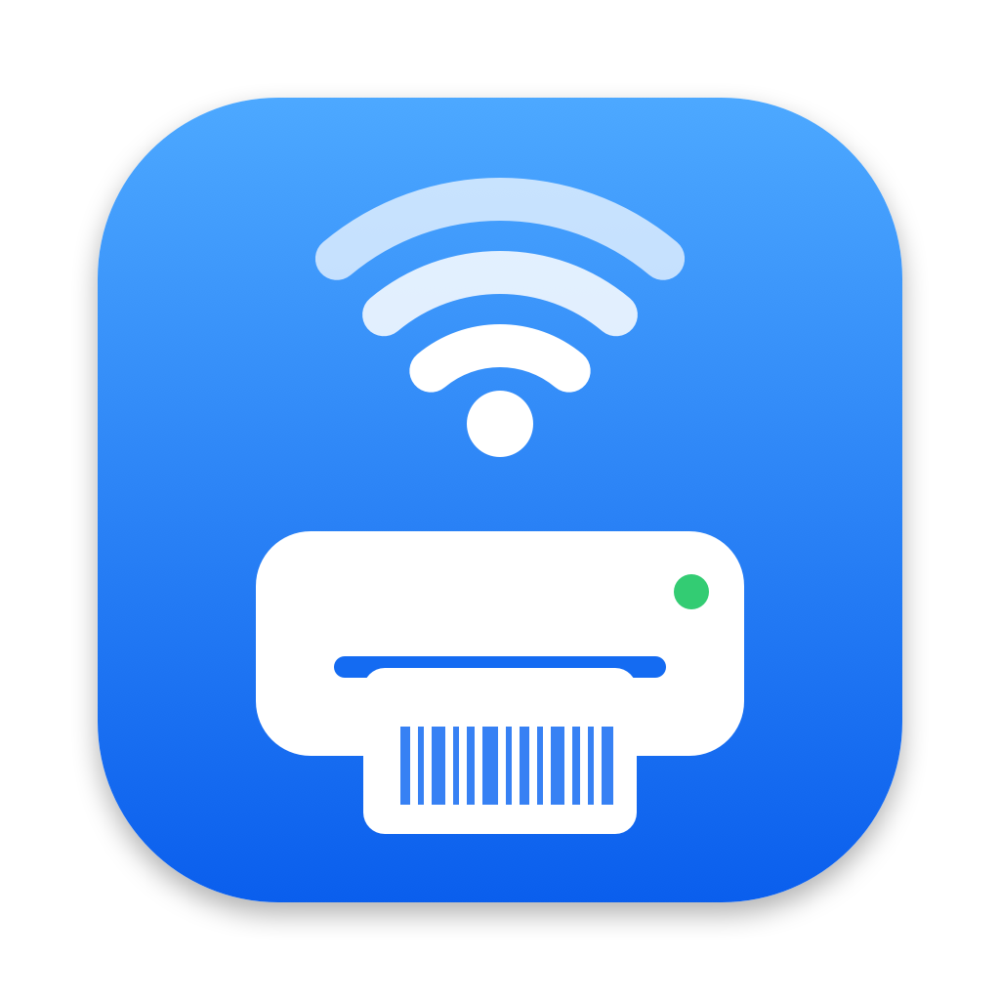
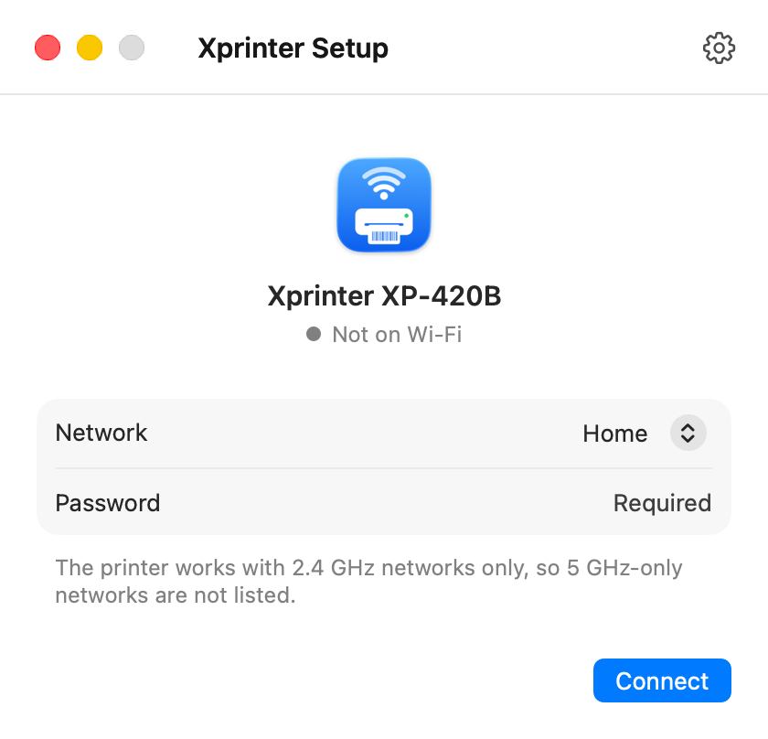
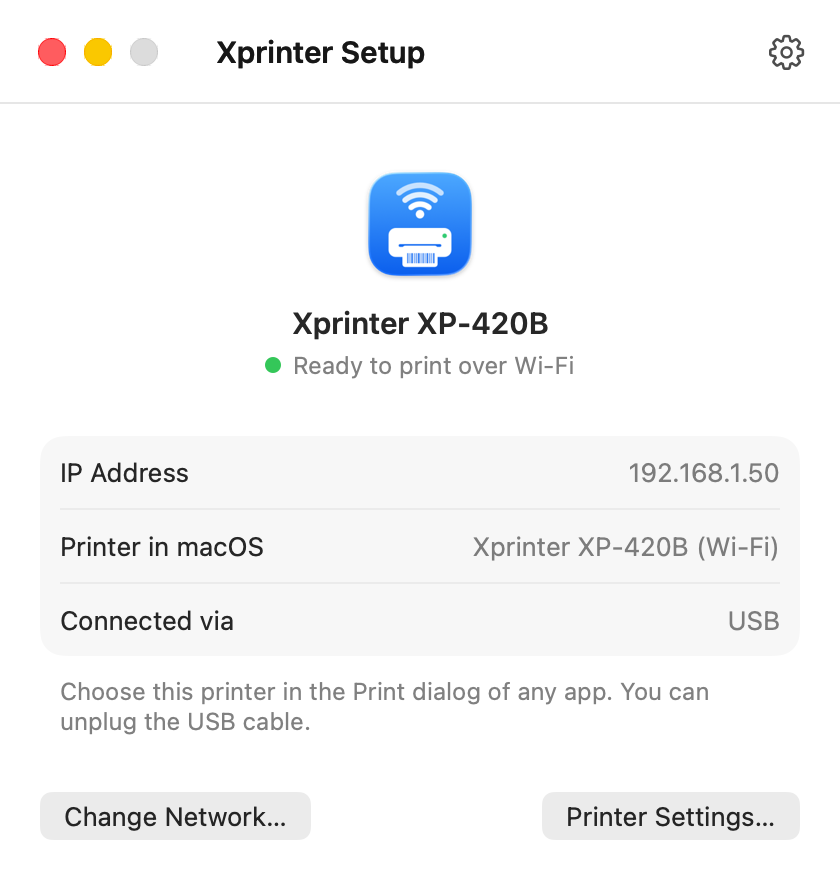
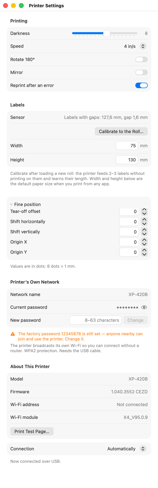
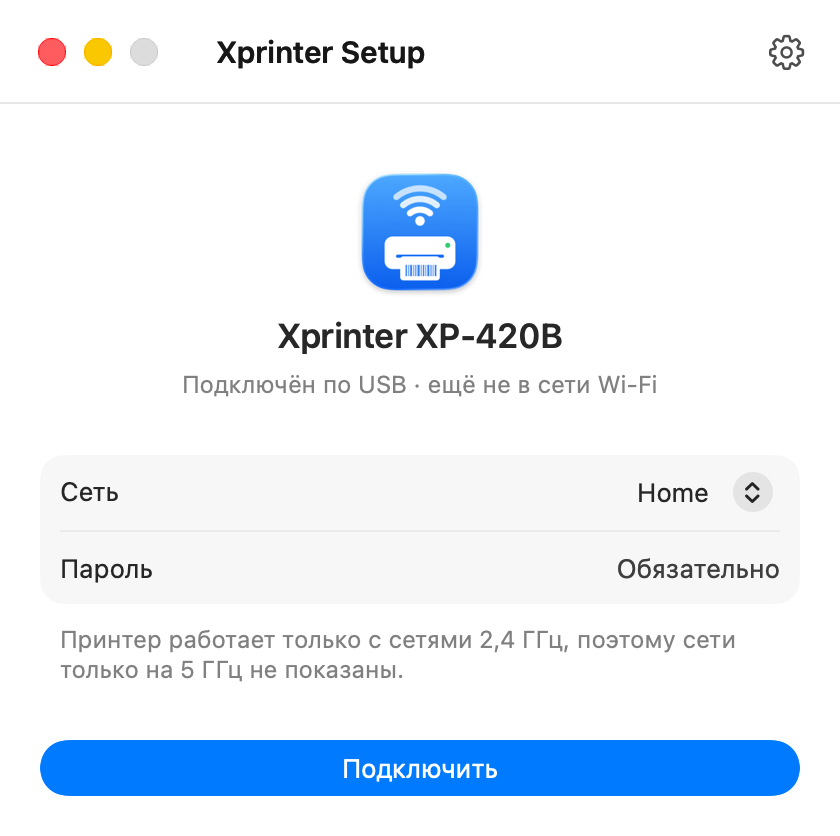
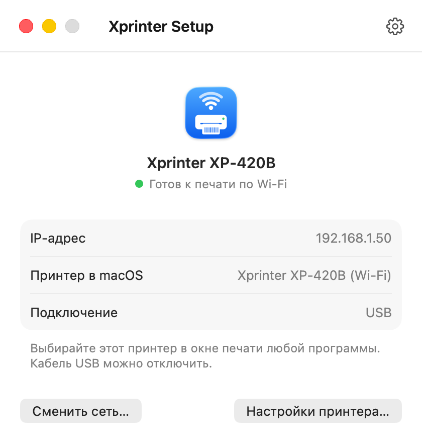
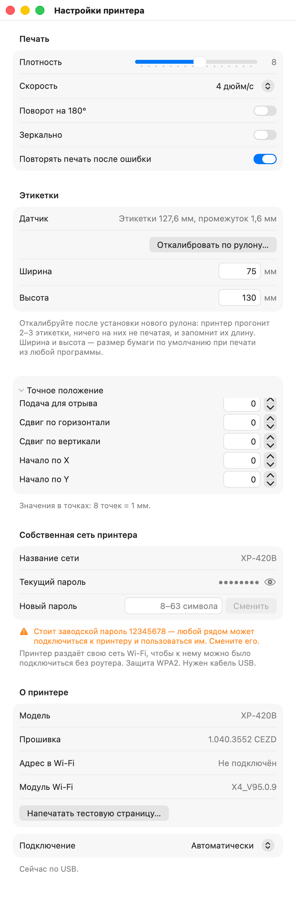

# Xprinter Setup for macOS

Connect an **Xprinter XP-420B** label printer to Wi-Fi from a Mac — no Windows, no vendor tool, no wasted labels.
Pick your network, type the password, press **Connect**. The app sends the settings over USB, asks the printer for its new address and adds it to macOS as a Wi-Fi printer.

[Русская версия ниже](#русский)

<p align="center">
  
  
  
</p>

## Tested printer

**Xprinter XP-420B (USB + Wi-Fi, 203 dpi, 108 mm)**, firmware 1.040.3552, Wi-Fi module X4_V95.0.9.

That is the only printer it has been tested on. Other Xprinter label printers that speak TSPL and have the same Wi-Fi module will *probably* work, because the vendor's Windows tool uses the same commands for all of them — but this has not been checked. Reports are welcome in [Issues](../../issues).

## Download

Get `Xprinter-Setup.zip` from [Releases](../../releases), unzip, and move **Xprinter Setup** to Applications.
The app is not notarized: on first launch, right-click it → **Open** → **Open**.
Requires macOS 13 or later (Apple Silicon and Intel).

**The Xprinter macOS driver is required** — macOS does not include it. Download it from [xprintertech.com](https://www.xprintertech.com/) (Support → Download) and install it first. The app can connect the printer to Wi-Fi and change its settings without the driver, but printing needs it.

## How to use

0. Install the Xprinter driver (see above).
1. Connect the printer with a USB cable and turn it on.
2. Choose your Wi-Fi network, enter the password, press **Connect**.
   The printer supports **2.4 GHz** networks only, so 5 GHz-only networks are not listed. macOS shows network names only to apps with Location access — allow it when asked, or choose **Other Network…** and type the name.
3. Wait about 30 seconds. When you see **All set**, choose the new “… (Wi-Fi)” printer in any Print dialog and unplug the cable.

Already set up? The app recognizes it and just says so; if the printer is on Wi-Fi but missing on this Mac, one click adds it — no password needed. Changing the Wi-Fi network itself requires the USB cable, so a typo in the password can't lock you out.

Tip: reserve the printer's address in your router (DHCP reservation), so it never changes.

**Another Mac?** Open the app on it: it finds the printer on the network by itself, or you type the printer's address (shown in the app on the first Mac, or as `STA IP` on the self-test page) and press **Add to This Mac**. The driver is needed on that Mac too.

**Label size.** In Printer Settings → Labels, type the width and height of your roll (for example 75 × 130 mm). It becomes the default paper size of the printer in macOS, so apps start with it. Change it when you load a roll of another size.

**Printer Settings (⌘,)** — over USB, or over Wi-Fi once the printer is set up (no cable needed), read from the printer and applied immediately: darkness (0–15), speed (2–6 in/s), rotate 180°, mirror, reprint after an error, fine position (tear-off offset, shift, origin), printer info. A test page is printed only when you ask for it.

Deliberately **not** included, to keep the printer safe: factory/head calibration commands, factory reset (it would also erase Wi-Fi settings), firmware and file operations, changing the printer's own access point, and paper-sensor calibration (feeds several labels; may be added after testing).

## Known printer limitation: Wi-Fi replies

The Wi-Fi module of the XP-420B (X4_V95.0.9) has a firmware bug, found while building this app: after power-on it passes only about **nine replies** from the printer back to the network (a reply is, for example, the printer's settings report). Then it hangs, and the printer stops answering on USB too, with the blue light still on, until it is turned off and on.

**Printing is not affected**: print jobs only send data to the printer — 20 such sessions in a row worked fine. It is not a driver problem either: the tests talked to the printer directly, without macOS printing.

What the app does about it: over Wi-Fi it reads the printer's settings once, when it finds the printer, and otherwise only checks that the printer is there (no reply needed). Changing settings over Wi-Fi sends the value without reading it back. Over USB there is no such limit. If the printer stops answering, the app says so and suggests turning it off and on.

Tip: change printer settings over USB when you can.

## The problem this solves

- Xprinter XP-420B Wi-Fi setup on Mac / macOS
- XP-420B does not connect to Wi-Fi, only shows its own network `XP-420B` (password `12345678`)
- `10.10.100.1` does not open, `ERR_CONNECTION_REFUSED`, no web configuration page
- Self-test page shows `STA IP: 0.0.0.0`
- Xprinter Diagnostic Tool / Wi-Fi config tool is Windows-only
- Print Label app does not find the printer

## Protocol

Plain TSPL text sent raw to the printer over USB (bulk endpoints of the printer-class interface, vendor ID `0x2D37`) or TCP port 9100. Replies come back on the same channel.

| Command | Effect |
|---|---|
| `WIFI CONNECTION "<ssid>","<password>"` | Join a Wi-Fi network (STA mode, DHCP) |
| `WIFI RESET` | Restart the Wi-Fi module to apply settings |
| `WIFI GETIP` | Reply `+OK=<address>` (`0.0.0.0` when not connected) |
| `ALLCONFIG` | Reply with all settings as `Key: Value` lines |
| `OUT "<text>"` | Echo text back — handy as an end-of-reply marker |
| `DENSITY n` (0–15), `SPEED n` (2–6), `DIRECTION r,m`, `SET REPRINT ON/OFF`, `OFFSET n dot`, `SHIFT x,y`, `REFERENCE x,y` | Print settings, stored in the printer |
| `SELFTEST` | Print the self-test page |

Strings have no escaping, so the network name and password cannot contain `"`. Without the app, from Terminal:

```sh
printf 'WIFI CONNECTION "MyWiFi","password"\r\nWIFI RESET\r\n' | lp -d Xprinter_XP_420B -o raw
```

The commands were identified for interoperability by examining what the vendor's Windows tool sends, and every command above was verified on a real XP-420B by writing a value and reading it back. No vendor code is included in this repository.

## Build from source

```sh
swift test                         # unit tests
XPRINTER_LIVE=1 swift test         # plus a read-only check with a printer on USB
./build-app.sh                     # → dist/Xprinter Setup.app and dist/Xprinter-Setup.zip
"dist/Xprinter Setup.app/Contents/MacOS/XprinterSetup" --screenshots Screenshots   # README screenshots (sample data, never touches a printer)
```

## Disclaimer

This is a free, unofficial project, not affiliated with Xprinter. It is provided **“as is”, without warranty of any kind** — you use it at your own risk. The authors are not liable for any damage to your printer, data or anything else. See [LICENSE](LICENSE) (MIT).

---

## Русский

Бесплатная программа для Mac, которая подключает принтер этикеток **Xprinter XP-420B** к Wi‑Fi — без Windows, без фирменной утилиты и без лишних этикеток. Выберите сеть, введите пароль, нажмите «Подключить»: программа отправит настройки по USB, узнает у принтера новый адрес и сама добавит его в macOS как Wi‑Fi принтер. Язык интерфейса — как в системе (русский или английский).

<p align="center">
  
  
  
</p>

**Проверено на:** Xprinter XP-420B (USB + Wi‑Fi, 203 dpi, 108 мм), прошивка 1.040.3552, модуль Wi‑Fi X4_V95.0.9. На других моделях Xprinter с таким же модулем Wi‑Fi программа, вероятно, тоже заработает, но это не проверялось — напишите в [Issues](../../issues), если попробуете.

**Установка:** скачайте `Xprinter-Setup.zip` в [Releases](../../releases), распакуйте, перенесите в «Программы». При первом запуске: правый клик → «Открыть» → «Открыть» (программа не нотаризована). Нужна macOS 13 или новее.

**Нужен драйвер Xprinter для macOS** — в macOS его нет. Скачайте его на [xprintertech.com](https://www.xprintertech.com/) (Support → Download) и установите заранее. Подключить принтер к Wi‑Fi и менять настройки программа может и без драйвера, но для печати он нужен.

**Как пользоваться:**

0. Установите драйвер Xprinter (см. выше).
1. Подключите принтер кабелем USB и включите.
2. Выберите сеть, введите пароль, нажмите «Подключить». Принтер работает **только с 2,4 ГГц**, поэтому сети только на 5 ГГц не показаны. Список сетей macOS показывает только с разрешением на геолокацию — разрешите или выберите «Другая сеть…».
3. Через ~30 секунд появится «Готово» — выбирайте новый принтер «(Wi-Fi)» в окне печати, кабель можно отключить.

Если принтер уже настроен, программа это видит и просто сообщает об этом; если он в Wi‑Fi, но не добавлен на этот Mac — добавляет одной кнопкой, без пароля. Сменить сеть Wi‑Fi можно только по кабелю USB — так опечатка в пароле не отрежет принтер от управления.

**Другой Mac?** Запустите программу на нём: она сама найдёт принтер в сети или попросит ввести его адрес (он есть в программе на первом Mac или в строке `STA IP` на тестовой странице) — и добавит его кнопкой «Добавить на этот Mac». Драйвер нужен и на нём.

**Размер этикеток.** В «Настройках принтера → Этикетки» укажите ширину и высоту рулона (например, 75 × 130 мм) — это станет размером бумаги по умолчанию, и программы будут сразу печатать в нём. Сменили рулон — поменяйте размер.

**Настройки принтера (⌘,)** — по USB, а после настройки и по Wi‑Fi, без кабеля: плотность, скорость, поворот, зеркальная печать, повтор после ошибки, точное положение, сведения о принтере. Тестовая страница печатается только по вашему запросу.

**Типичные проблемы, которые решает программа:** XP-420B не подключается к Wi‑Fi, видна только сеть `XP-420B` (пароль `12345678`); не открывается `10.10.100.1`; на тестовой странице `STA IP: 0.0.0.0`; утилита Xprinter Diagnostic Tool работает только на Windows; приложение Print Label не находит принтер; как настроить Wi‑Fi принтера этикеток Xprinter на MacBook.

**Известное ограничение принтера.** В прошивке модуля Wi‑Fi XP-420B (X4_V95.0.9) есть ошибка, которую мы нашли при разработке: после включения он передаёт обратно в сеть только около **девяти ответов** принтера (например, отчётов о настройках), а потом зависает — и принтер перестаёт отвечать даже по USB, хотя синий индикатор горит; помогает только выключить и включить. **Печать это не затрагивает**: задания только отправляют данные в принтер — 20 таких сеансов подряд прошли без сбоев. Драйвер тут ни при чём — тесты шли напрямую, без него. Программа поэтому по Wi‑Fi читает настройки один раз, а дальше лишь проверяет, что принтер на месте; если он перестал отвечать — подскажет перезагрузить. Настройки по возможности меняйте по USB.

**Отказ от ответственности.** Программа бесплатная и неофициальная, не связана с компанией Xprinter. Она предоставляется **«как есть», без каких-либо гарантий** — вы используете её на свой страх и риск. Авторы не несут ответственности за возможный ущерб принтеру, данным или чему-либо ещё. Лицензия — [MIT](LICENSE).
