
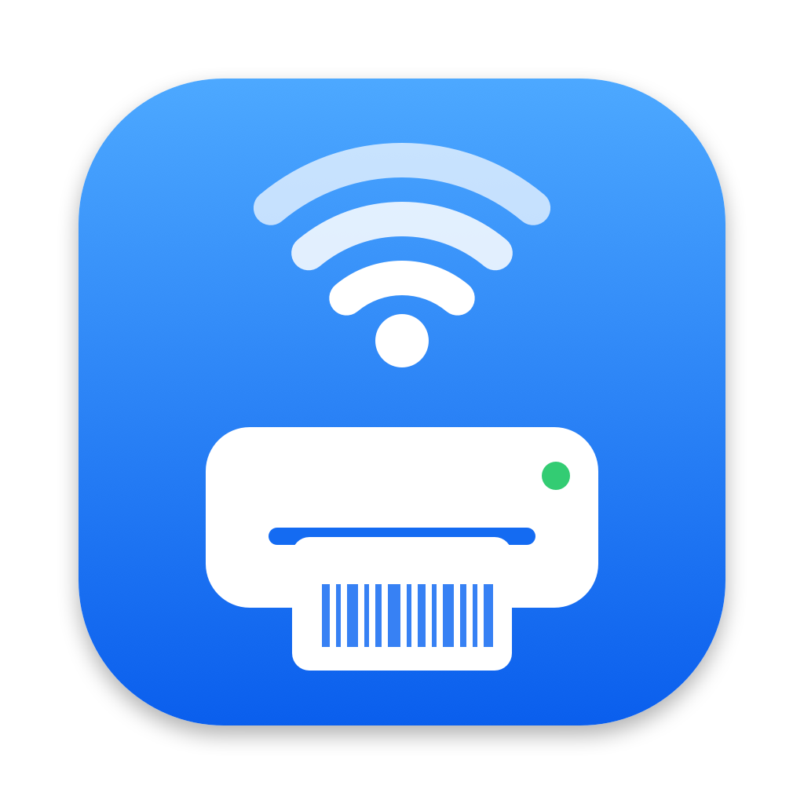

<h1 align="center">Xprinter Setup для macOS</h1>

  Настройка Wi-Fi принтера этикеток <b>Xprinter XP-420B</b> на Mac — без Windows, без фирменной утилиты и без лишних этикеток. 
  <a href="README.md">English</a> · <b>Русский</b>

  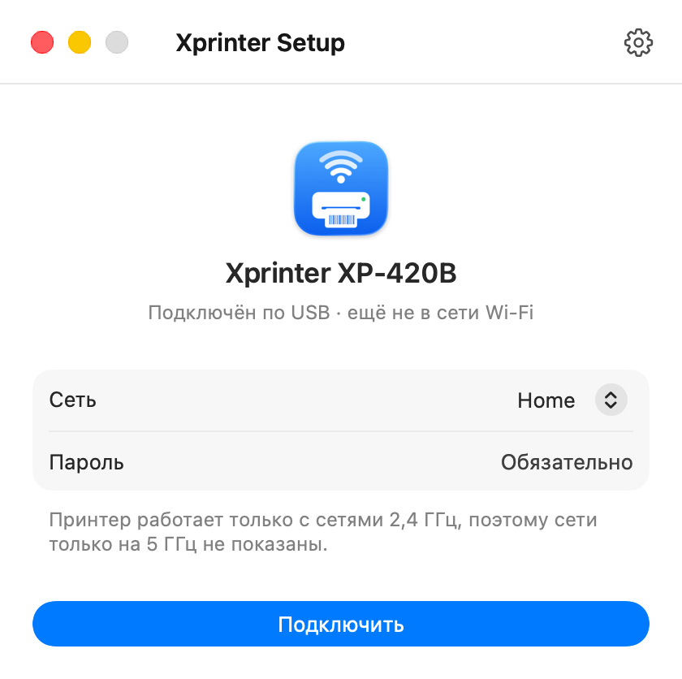
  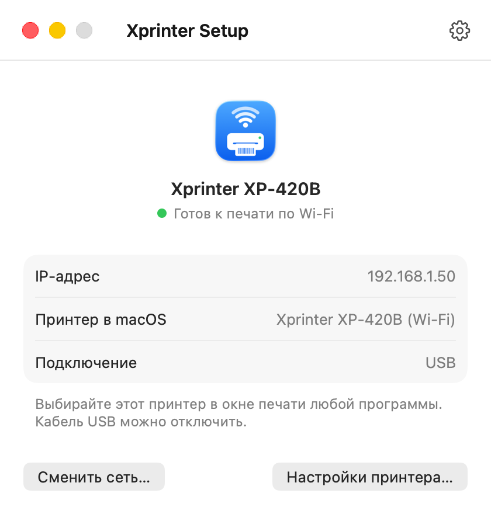
  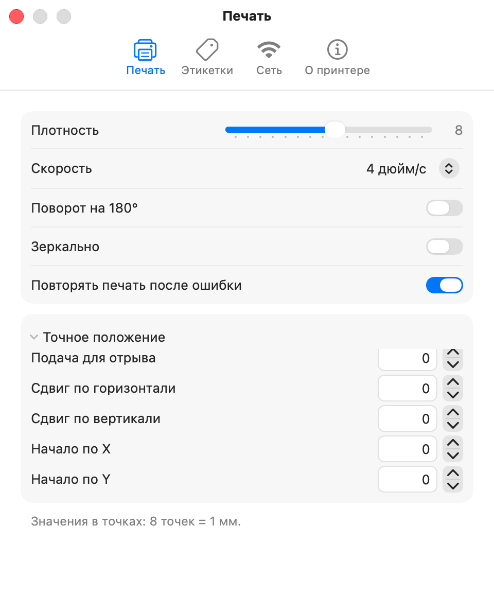

Подключение · Готов к печати · Настройки принтера

## Что умеет

- **Подключает принтер к вашему Wi-Fi одной кнопкой.** Выберите сеть (показаны только сети 2,4 ГГц — 5 ГГц принтер не поддерживает), введите пароль, нажмите «Подключить». Программа отправит настройки по USB, узнает у принтера новый адрес и сама добавит его в macOS как Wi-Fi принтер. Без тестовых страниц.
- **Узнаёт уже настроенный принтер** и добавляет его на другой Mac — найдёт в сети или по адресу.
- **Настройки принтера** (⌘,) по вкладкам, как в программах Apple — по USB или по Wi-Fi без кабеля: плотность, скорость, поворот на 180°, зеркальная печать, повтор после ошибки, точное положение.
- **Этикетки:** этикетки с промежутком или непрерывная лента (переключение ничего не прогоняет), **калибровка** — принтер прогонит 2–3 чистые этикетки и запомнит их длину — и размер по умолчанию для всех программ.
- **Состояние принтера:** открыта крышка, закончились этикетки, замятие.
- **Лечение без кнопки питания:** «Переподключить Wi-Fi» и «Перезапустить принтер» (см. [Известное ограничение](#известное-ограничение-принтера-wi-fi-работает-около-30-минут)).
- **Собственная сеть принтера:** посмотреть и сменить пароль встроенной сети принтера (заводской — `12345678`).
- Русский и английский — как в системе. Работает на Mac с Apple Silicon и Intel.

## Проверено на

**Xprinter XP-420B (USB + Wi-Fi, 203 dpi, 108 мм)**, прошивка 1.040.3552, модуль Wi-Fi X4_V95.0.9.

Других принтеров для проверки не было. На других этикеточных Xprinter с языком TSPL и таким же модулем Wi-Fi программа, *вероятно*, заработает — фирменная утилита для Windows отправляет им те же команды, — но это не проверялось. Напишите в [Issues](../../issues), если попробуете.

## Установка

1. **Установите драйвер Xprinter для macOS** с [xprintertech.com](https://www.xprintertech.com/) (Support → Download). В macOS его нет. Настроить Wi-Fi программа может и без него, но для печати он нужен.
2. Скачайте `Xprinter-Setup.zip` в [Releases](../../releases/latest), распакуйте, перенесите **Xprinter Setup** в «Программы».
3. Откройте её. Программа не заверена Apple, поэтому в первый раз macOS её заблокирует — так и должно быть:
   1. macOS сообщит: *Файл «Xprinter Setup» не был открыт*. Нажмите **«Готово»**.
   2. Откройте **«Системные настройки → Конфиденциальность и безопасность»** и прокрутите вниз до раздела **«Безопасность»**: *Файл «Xprinter Setup» заблокирован для защиты Вашего Mac.* Нажмите **«Все равно открыть»**.
   3. macOS спросит: *Открыть файл «Xprinter Setup»?* Нажмите **«Все равно открыть»** и подтвердите Touch ID или паролем.

   

     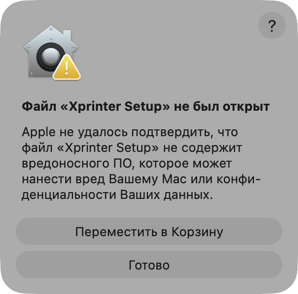
     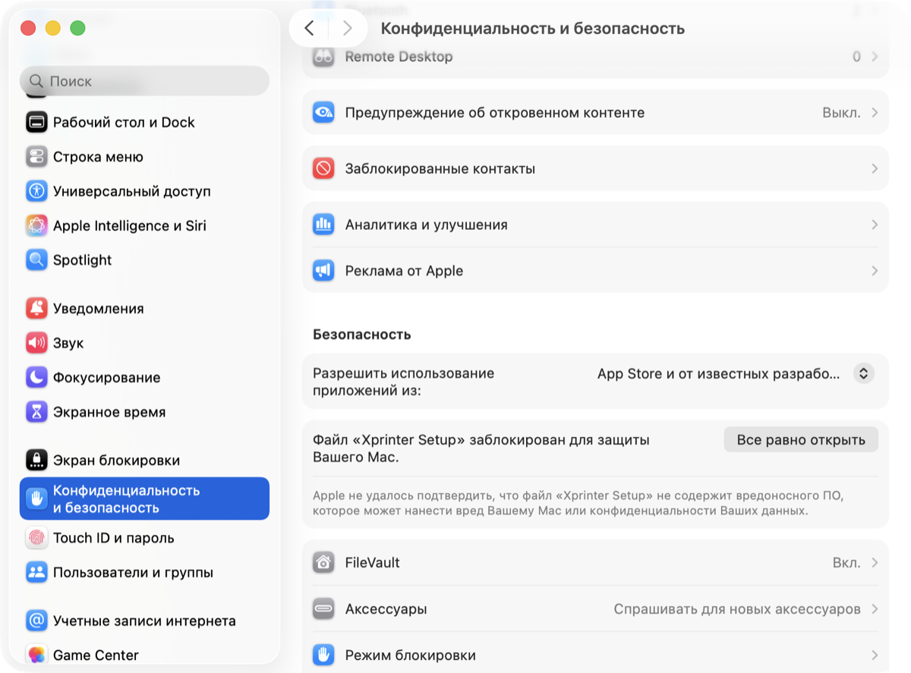
     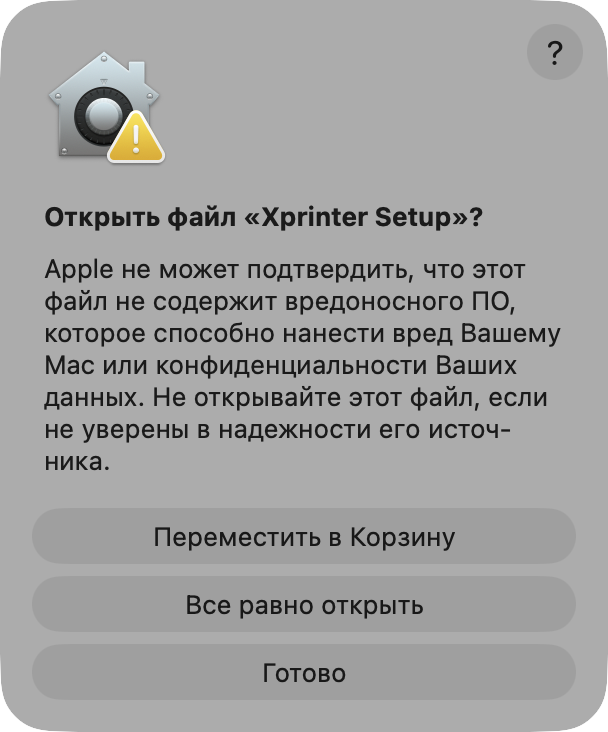
   

   macOS это запомнит, дальше программа будет открываться как обычно. Официальная инструкция Apple: [Открытие приложения от неустановленного разработчика](https://support.apple.com/ru-ru/guide/mac-help/mh40616/mac). В macOS 14 и старше также работает правый клик → «Открыть» → «Открыть»; с macOS 15 — уже нет.

   Удобнее через Терминал? Команда `xattr -dr com.apple.quarantine "/Applications/Xprinter Setup.app"` снимает пометку «скачано из интернета», после этого программа открывается как обычно.

Нужна macOS 13 или новее.

## Как пользоваться

1. Подключите принтер кабелем USB и включите его.
2. Выберите сеть Wi-Fi, введите пароль, нажмите «Подключить».
3. Примерно через 30 секунд точка станет зелёной: «Готов к печати по Wi-Fi». Выбирайте «Xprinter XP-420B (Wi-Fi)» в окне печати любой программы, кабель можно отключить.

**Совет:** закрепите адрес принтера в роутере (резервирование DHCP), чтобы он не менялся.

**Другой Mac?** Установите на нём драйвер и откройте программу. Она найдёт принтер в сети или попросит его адрес (он есть в программе на первом Mac или в строке `STA IP` на тестовой странице) — затем «Добавить на этот Mac».

**Новый рулон?** «Настройки принтера → Этикетки → Откалибровать…» (по USB). **Непрерывная лента?** «Настройки принтера → Этикетки → Бумага → Непрерывная лента»; вернуться к этикеткам можно так же — мгновенно и без прогона бумаги, принтер помнит длину этикетки. Затем укажите ширину и высоту этикетки — это станет размером бумаги по умолчанию, и программы будут сразу печатать в нём.

  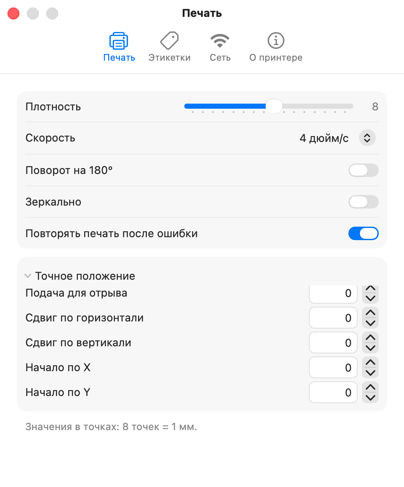
  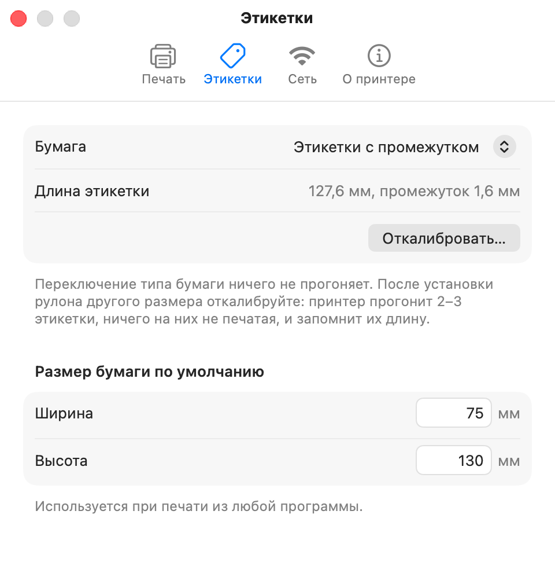
  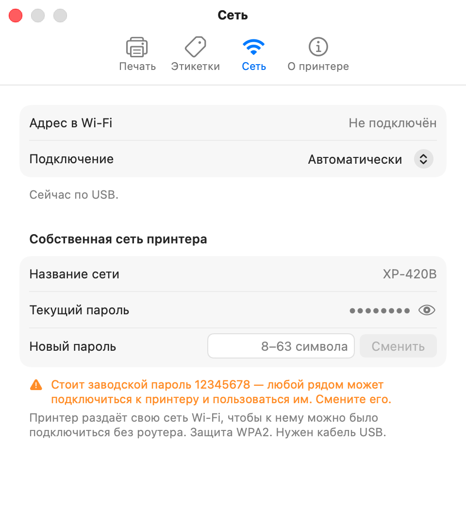
  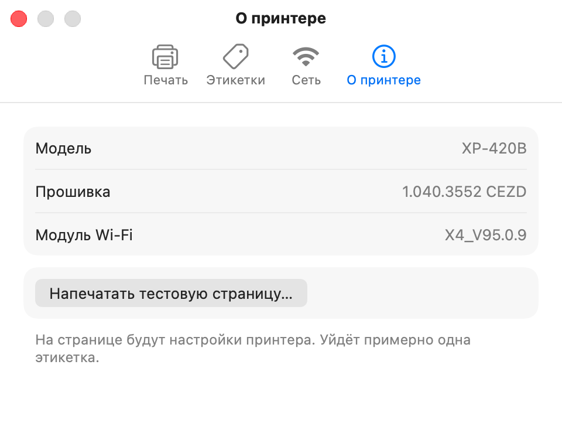

**Собственная сеть принтера.** Принтер раздаёт и свою сеть Wi-Fi (`XP-420B`) — для подключения напрямую, без роутера. С заводским паролем `12345678` к ней может подключиться любой рядом — смените его в «Настройках принтера → Собственная сеть принтера» (по USB, WPA2). Печать с Mac идёт через роутер, её это не затрагивает.

**Подключение.** По умолчанию программа работает по USB, если кабель подключён, и по Wi-Fi — если нет. В «Настройках принтера → Подключение» можно выбрать что-то одно. Сменить сеть Wi-Fi можно только по кабелю — так опечатка в пароле не отрежет принтер от управления.

## Известное ограничение принтера: Wi-Fi работает около 30 минут

Выяснено при разработке на XP-420B с модулем Wi-Fi X4_V95.0.9 и роутером Xiaomi. Повторено четыре раза — с нагрузкой и без:

- Примерно через **30–35 минут после запуска модуля Wi-Fi** он сам начинает сбоить: либо **выпадает из сети**, либо **зависает посреди передачи** — и тогда весь принтер перестаёт отвечать, даже по USB, хотя синий индикатор горит.
- В этот момент не проходит и печать по Wi-Fi. **Печать по USB это не затрагивает**, пока сам принтер не завис.
- Это **не драйвер** (тесты шли напрямую к принтеру) и **не нагрузка** (сбой случается и после 30 минут полной тишины).
- Догадка, не проверенная: многие дешёвые модули Wi-Fi ломаются, когда роутер обновляет ключи шифрования, — время совпадает.

**Что помогает — всё проверено на принтере, настройки сохраняются:**

| Проблема | Что делать |
|---|---|
| Принтер выпал из сети | «Переподключить Wi-Fi» в программе (`WIFI RESET` по USB) — ~6 с |
| Принтер завис, не отвечает даже по USB | «Перезапустить принтер» в программе (как «Reset Printer» в утилите Xprinter: `ESC ! exit`, `ESC ! R`) — ~6 с |
| Кабеля под рукой нет | Выключить и включить принтер |

По сети испорченный модуль не вылечить: он не пропускает и команду лечения. Программа как можно реже просит принтер отвечать по Wi-Fi и никогда не опрашивает его в фоне.

**Если печатаете по Wi-Fi постоянно**, попробуйте в роутере (пока не проверено): отдельную сеть 2,4 ГГц, фиксированный канал (1, 6 или 11), выключить «умное» объединение диапазонов, увеличить интервал обновления группового ключа, если такая настройка есть. Нашли настройку, при которой принтер живёт дольше 30 минут, — напишите в Issues.

## Частые вопросы

**macOS блокирует программу: «Файл „Xprinter Setup“ не был открыт».** Программа не заверена Apple (для этого нужен платный аккаунт разработчика). Откройте её один раз через **«Системные настройки → Конфиденциальность и безопасность → Все равно открыть»** — см. [Установка](#установка), шаг 3.

**Зачем программе геопозиция?** macOS показывает названия сетей Wi-Fi только программам с доступом к геопозиции. Программа спрашивает его только при выборе сети и использует только для списка сетей. Можно отказать и ввести название в «Другая сеть…».

**Моей сети нет в списке.** Принтер работает только с 2,4 ГГц, сети только на 5 ГГц скрыты. Если у роутера одно название для обоих диапазонов, сеть будет в списке; иначе включите 2,4 ГГц в роутере.

**Принтер не найден / «Не отвечает».** Подключите кабель USB — программа предложит «Переподключить Wi-Fi» или «Перезапустить принтер». Без кабеля — выключите и включите принтер.

**Печать съезжает с этикеток.** Откалибруйте по рулону («Настройки принтера → Этикетки»). После калибровки принтер при закрытии крышки прогоняет одну этикетку — так он выравнивается по промежутку, это нормально.

**Chrome (а также Comet, Яндекс Браузер, Edge) не показывает принтер.** Браузеры на Chromium показывают только принтер по умолчанию и недавно использованные: откройте список «Принтер» → **«Ещё…»**. Для этикеток лучше нажать **⌥⌘P** (или «Печать с помощью системного диалогового окна») — системное окно macOS показывает все принтеры и учитывает размер этикеток и настройки драйвера. Safari и Firefox используют его сразу.

**При печати ошибка «не установлен драйвер».** Установите драйвер Xprinter для macOS (см. «Установка»).

## Что сознательно не включено

Ради сохранности принтера: сброс к заводским настройкам (`ESC ! C` — стирает всё, включая Wi-Fi), заводские команды калибровки головки, прошивка и операции с файлами, постоянный IP-адрес в принтере (лучше закрепить адрес в роутере), открытая сеть или WEP для собственной сети принтера. У XP-420B нет: ножа, отделителя, красящей ленты, Ethernet, Bluetooth.

## Приватность

Программа хранит только ваш выбор подключения и — если вы его вводили — адрес принтера. Она общается только с принтером (по USB или в вашей локальной сети) и с системой печати macOS. Никакой аналитики, никакого интернета. Пароль от Wi-Fi уходит прямо в принтер и нигде не сохраняется.

## Какие проблемы решает

- Как настроить Wi-Fi принтера Xprinter XP-420B на Mac / MacBook / macOS
- XP-420B не подключается к Wi-Fi, видна только его сеть `XP-420B` (пароль `12345678`)
- Не открывается `10.10.100.1`, `ERR_CONNECTION_REFUSED`, нет веб-страницы настройки
- На тестовой странице `STA IP: 0.0.0.0`
- Утилита Xprinter Diagnostic Tool работает только на Windows
- Приложение Print Label не находит принтер
- Принтер через какое-то время пропадает из Wi-Fi

## Протокол

Полный справочник по командам принтера — что найдено в фирменной утилите, что проверено, форматы ответов, поиск в сети, поведение модуля Wi-Fi и заметки по печати в macOS: **[docs/PROTOCOL.md](docs/PROTOCOL.md)** (на английском). Сборка из исходников — в [английской версии README](README.md#build-from-source). Команды выяснены для совместимости по тому, что отправляет фирменная утилита для Windows, и проверены на настоящем XP-420B (кроме отмеченных в таблице). Кода Xprinter в репозитории нет.

## Отказ от ответственности

Программа бесплатная и неофициальная, не связана с компанией Xprinter. Она предоставляется **«как есть», без каких-либо гарантий** — вы используете её на свой страх и риск. Авторы не несут ответственности за возможный ущерб принтеру, данным или чему-либо ещё. [Лицензия MIT](LICENSE).
